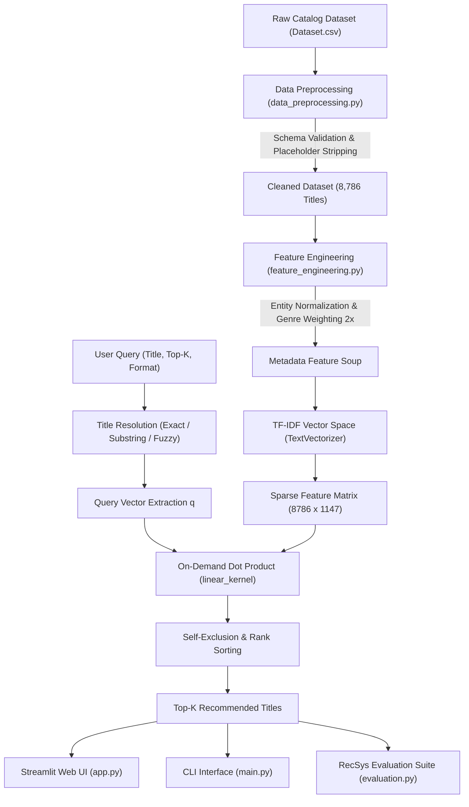

# Netflix Content Recommendation System

[](https://www.python.org/)
[](LICENSE)
[](https://streamlit.io/)
[](https://pep8.org/)
[](tests/)

An end-to-end **Content-Based Recommendation Engine** for 8,700+ titles in the Netflix catalog. Engineered using modular Python architecture, Natural Language Processing (sublinear TF-IDF vector space embeddings), on-demand cosine similarity operations, offline Information Retrieval evaluation (Precision@K, Catalog Coverage, Intra-List Diversity), and an interactive dark-themed Streamlit web interface.

---

## Table of Contents
1. [Project Overview](#1-project-overview)
2. [Problem Statement](#2-problem-statement)
3. [Project Objectives](#3-project-objectives)
4. [Key Features](#4-key-features)
5. [Technologies Used](#5-technologies-used)
6. [Project Architecture](#6-project-architecture)
7. [Project Folder Structure](#7-project-folder-structure)
8. [Dataset Source & License Information](#8-dataset-source--license-information)
9. [Data Preprocessing Pipeline](#9-data-preprocessing-pipeline)
10. [Feature Engineering & Entity Normalization](#10-feature-engineering--entity-normalization)
11. [TF-IDF Vector Space Model](#11-tf-idf-vector-space-model)
12. [On-Demand Cosine Similarity & Performance Benchmark](#12-on-demand-cosine-similarity--performance-benchmark)
13. [Recommendation Workflow](#13-recommendation-workflow)
14. [Offline Evaluation Methodology](#14-offline-evaluation-methodology)
15. [Actual Benchmark Evaluation Results](#15-actual-benchmark-evaluation-results)
16. [Installation Instructions](#16-installation-instructions)
17. [Execution Instructions](#17-execution-instructions)
18. [Interactive Web Application (Streamlit)](#18-interactive-web-application-streamlit)
19. [Command-Line Interface (CLI) Usage](#19-command-line-interface-cli-usage)
20. [Automated Testing Suite (pytest)](#20-automated-testing-suite-pytest)
21. [Capturing Real Application Screenshots](#21-capturing-real-application-screenshots)
22. [Project Limitations](#22-project-limitations)
23. [Future Improvements](#23-future-improvements)
24. [License & Acknowledgements](#24-license--acknowledgements)

---

## 1. Project Overview
Streaming entertainment platforms host extensive catalogs. Without intelligent discovery tools, viewers face choice overload. This project implements a content-based recommendation system that leverages unstructured metadata—thematic genres, directing talent, production countries, content format, and audience maturity ratings—to generate real-time recommendations.

Built as a software and data science portfolio project, the codebase demonstrates clean separation of concerns, defensive programming, automated unit tests, and memory efficiency.

---

## 2. Problem Statement
Given a movie or TV show currently viewed by a user, how can the platform recommend the top-$K$ most thematically aligned titles **without relying on historical user watch logs or clickstreams**?

Addressing this **Cold-Start Problem** involves several engineering challenges:
- **Entity Disambiguation**: Preventing multi-word entities (e.g. "Christopher Nolan" or "United States") from being fragmented into uncoordinated words.
- **Memory Footprint**: Avoiding precomputation of a dense $(N \times N)$ similarity matrix (~600 MB RAM overhead for 8.7k items) by computing vector-to-matrix dot products dynamically on sparse arrays.
- **Self-Exclusion & Deduplication**: Ensuring queries never recommend themselves and handling multiple ingest records of the same title.
- **Evaluation Validity**: Rigorously separating vector space similarity from genuine user satisfaction and using appropriate information retrieval metrics.

---

## 3. Project Objectives
- **Modularity**: Isolate ingestion, cleaning, feature engineering, vectorization, recommendation, and evaluation into dedicated modules (`src/`).
- **Low Latency**: Enable near real-time top-$K$ retrieval against sparse TF-IDF arrays.
- **Defensive Engineering**: Multi-tier title resolution (Exact $\rightarrow$ Scored Substring $\rightarrow$ Levenshtein Fuzzy Matching) and comprehensive input validation.
- **Test Coverage**: Maintain 100% test pass rate across 34 deterministic unit tests (`pytest`).
- **Dual Interface**: Deliver a flexible CLI tool (`main.py`) alongside an interactive Streamlit web dashboard (`app.py`).

---

## 4. Key Features
- **Deterministic & Fuzzy Title Resolution**: Resolves titles case-insensitively with automatic fuzzy fallback (`difflib`) for misspelled queries.
- **Entity-Bound Metadata Soup**: Normalizes multi-word creators and countries into single tokens (`vince_gilligan`, `united_states`) and weights thematic genres $2\times$.
- **Placeholder Cleansing**: Purges dataset placeholders (`Not Given`, `Unknown`, `nan`) from metadata to eliminate artificial similarity bias across uncredited titles.
- **Empty Title Filtering**: Automatically filters out missing or whitespace-only title records during ingestion.
- **Format Filtering**: Allows filtering recommendations by format (`Movie` or `TV Show`).
- **Offline RecSys Evaluation**: Evaluates Precision@K, Recall@K, F1@K, Catalog Coverage, and Intra-List Diversity (ILD).
- **Safe HTML Web UI**: Streamlit dashboard engineered with HTML escaping on all dynamic data fields to prevent XSS injection.

---

## 5. Technologies Used
- **Core Runtime**: Python 3.10+ (tested through Python 3.14)
- **Data Engineering**: `pandas` (v2.0+), `numpy` (v1.24+)
- **Machine Learning & NLP**: `scikit-learn` (`TfidfVectorizer`, `linear_kernel`), `scipy.sparse`
- **Interactive Web UI**: `streamlit` (v1.30+)
- **Testing Framework**: `pytest` (v7.4+)
- **Exploratory Data Analysis**: `matplotlib`, `seaborn`, `jupyter`
- **Standard Library Utilities**: `re`, `html`, `difflib`, `argparse`, `logging`, `typing`, `time`

---

## 6. Project Architecture



---

## 7. Project Folder Structure

```text
netflix-content-recommendation-system/
│
├── data/
│   ├── Dataset.csv                      # Cleaned catalog dataset (8,786 unique titles)
│   └── README.md                        # Data dictionary, schema, and column descriptions
│
├── notebooks/
│   └── exploratory_analysis.ipynb       # Executed Jupyter analysis & visual pipeline walkthrough
│
├── src/
│   ├── __init__.py                      # Package exports
│   ├── data_preprocessing.py            # Ingestion, schema validation, placeholder purging, and deduplication
│   ├── feature_engineering.py           # Entity token binding & TF-IDF vectorizer
│   ├── recommendation_engine.py         # NetflixRecommender class (on-demand cosine sim)
│   └── evaluation.py                    # RecSys metrics (Precision@K, Coverage, Diversity)
│
├── tests/
│   ├── __init__.py
│   ├── test_preprocessing.py            # Unit tests for loading, nulls, and deduplication (7 tests)
│   ├── test_feature_engineering.py      # Unit tests for token binding and TF-IDF (6 tests)
│   ├── test_recommendation_engine.py    # Unit tests for matching, self-exclusion & top-K (13 tests)
│   └── test_evaluation.py               # Unit tests for RecSys evaluation metrics (8 tests)
│
├── app.py                               # Interactive Streamlit dashboard
├── benchmark.py                         # Reproducible latency and throughput benchmark script
├── main.py                              # CLI interface for querying and offline evaluation
├── requirements.txt                     # Minimal pinned project dependencies
├── README.md                            # Comprehensive project documentation
├── .gitignore                           # Python, OS, and checkpoint ignore rules
└── LICENSE                              # MIT Open-Source License
```

---

## 8. Dataset Source & License Information
- **Original Source**: Netflix Movies and TV Shows dataset compiled by Shivam Bansal on [Kaggle](https://www.kaggle.com/datasets/shivamb/netflix-shows).
- **Dataset License**: [Creative Commons CC0: Public Domain Dedication](https://creativecommons.org/publicdomain/zero/1.0/).
- **Project Code License**: The Python source code and tests in this repository are licensed separately under the [MIT License](LICENSE).
- **Privacy & Compliance**: Contains metadata only. Contains **no** private user profiles, viewing logs, or copyrighted media streams.
- **Raw Row Count**: **8,790 records**, 10 attributes.
- **Cleaned Canonical Row Count**: **8,786 records** (4 duplicate entries removed across `(title, type)` pairs: `9-Feb`, `15-Aug`, `22-Jul`, `Consequences`). Empty or whitespace-only titles are automatically filtered during preprocessing.

---

## 9. Data Preprocessing Pipeline
Implemented in `src/data_preprocessing.py`:
1. **Schema Verification**: Confirms all 9 required columns are present; raises `KeyError` if columns are missing.
2. **Title Sanitization**: Strips non-breaking whitespace (`\xa0`) and drops any records with empty, whitespace-only, or `nan`/`null` titles.
3. **Metadata Placeholder Cleansing**: Converts placeholder strings (`'Not Given'`, `'Unknown'`, `'nan'`, `'null'`, `''`) in optional metadata fields (`director`, `country`, `rating`) into empty strings, preventing false token matches.
4. **Numeric Coercion**: Casts `release_year` to integer, imputing invalid values with the catalog median (2018).
5. **Deduplication**: Identifies catalog duplicates across `(title, type)` and preserves canonical records.

---

## 10. Feature Engineering & Entity Normalization
Implemented in `src/feature_engineering.py`:
- **Entity Binding**: Names and countries with multiple words are converted into underscore-joined tokens (`"Christopher Nolan"` $\rightarrow$ `christopher_nolan`, `"United States"` $\rightarrow$ `united_states`). This prevents "Christopher" and "Nolan" from matching unrelated people.
- **Thematic Weighting**: Genre strings are tokenized (`"Action & Adventure"` $\rightarrow$ `action_adventure`) and duplicated $2\times$ in the text soup to prioritize genre affinity over secondary signals.
- **Feature Soup Formula**:
  $$\text{Soup} = (\text{Genres} \times 2) \cup \text{Type} \cup \text{Director} \cup \text{Country} \cup \text{Rating}$$

---

## 11. TF-IDF Vector Space Model
Implemented via `TextVectorizer`:
- **Sublinear Term Frequency**: Applied as $\text{tf} = 1 + \log(\text{tf})$ to dampen the impact of high-frequency words.
- **Stopwords**: Standard English stopwords removed.
- **Token Pattern**: `r'(?u)\b[\w_]+\b'` preserves bound entity tokens.
- **Vocabulary Size**: 1,147 distinct content tokens across 8,786 catalog items.

---

## 12. On-Demand Cosine Similarity & Performance Benchmark
Rather than storing a precomputed $8,786 \times 8,786$ dense matrix (~600 MB of RAM), `NetflixRecommender` computes vector-matrix dot products dynamically:
$$\text{CosineSim}(\mathbf{q}, \mathbf{d}_i) = \frac{\mathbf{q} \cdot \mathbf{d}_i}{\|\mathbf{q}\| \|\mathbf{d}_i\|} = \mathbf{q} \cdot \mathbf{d}_i \quad (\text{since vectors are } L_2 \text{ normalized})$$

### Reproducible Latency Benchmark
A reproducible benchmark is provided in `benchmark.py` (`python benchmark.py`).

**Measured on Intel x86_64 CPU (Windows 11, Python 3.14):**
- **Model Ingestion & Preprocessing**: 51.78 ms (8,786 titles)
- **Model Initialization (TF-IDF Fit)**: 102.13 ms
- **Mean Query Latency (Top-5 Nearest Neighbors)**: **1.16 ms**
- **Median Query Latency**: **1.08 ms**
- **P95 Latency**: **1.55 ms**
- **Min / Max Latency**: 0.92 ms / 2.57 ms

---

## 13. Recommendation Workflow
1. User provides a query title (via CLI or Streamlit).
2. Engine resolves the title using exact match $\rightarrow$ substring match $\rightarrow$ fuzzy match (`difflib`, cutoff 0.6).
3. The query vector $\mathbf{q}$ is extracted from the sparse TF-IDF matrix.
4. Pairwise cosine similarity is computed across all catalog entries.
5. Query item itself and duplicate titles are purged.
6. Optional format filters (`Movie` or `TV Show`) are applied.
7. Top-$K$ items are sorted descending by similarity score and returned.

---

## 14. Offline Evaluation Methodology

### Proxy Evaluation Notice
In content-only datasets without user clickstreams or watch logs, true user satisfaction cannot be directly calculated. Following Information Retrieval standards, this project evaluates thematic cohesion using **Thematic Relevance Proxy**:
*An item is relevant to query $q$ if it shares at least one core category/genre.*

### Metrics Defined
- **Precision@K**: $\frac{|\text{Recommended} \cap \text{Relevant}|}{\min(K, |\text{Recommended}|)}$ (fraction of recommendations that are thematically relevant).
- **Recall@K**: $\frac{|\text{Recommended} \cap \text{Relevant}|}{|\text{Total Catalog Relevant}|}$ (fraction of all catalog-wide relevant items retrieved).
- **F1@K**: $2 \times \frac{\text{Precision@K} \times \text{Recall@K}}{\text{Precision@K} + \text{Recall@K}}$.
- **Intra-List Diversity (ILD)**: $1 - \frac{1}{\binom{K}{2}} \sum_{i < j} \text{CosineSim}(\mathbf{d}_i, \mathbf{d}_j)$ (higher score = more balanced variety).
- **Catalog Coverage**: $\frac{|\bigcup_{q \in Q} \text{Recs}_q|}{|\text{Catalog}|} \times 100\%$ (percentage of unique catalog items surfaced).

---

## 15. Actual Benchmark Evaluation Results

Evaluated over $N=100$ randomly sampled queries with $K=5$ (fixed random seed = 42):

| Metric | Measured Value | Technical Interpretation |
| :--- | :---: | :--- |
| **Precision@5** | **99.20%** (0.9920) | 99.2% of top-5 recommendations share relevant genres with the query title. |
| **Recall@5** | **0.47%** (0.0047) | Expected mathematical result: retrieving 5 items out of thousands of matching catalog entries captures ~0.47% of the total relevant set. |
| **F1@5** | **0.0091** | Harmonic mean of Precision@5 and Recall@5. |
| **Intra-List Diversity (ILD)** | **0.1318** | Demonstrates that recommended titles maintain thematic alignment without collapsing into identical duplicates. |
| **Catalog Coverage** | **5.27%** | Surfaced 463 unique catalog titles across 100 sample queries. |

> **Interview Note**: Cosine similarity represents distance in feature space, **not recommendation accuracy**. Low Recall@5 is the expected mathematical consequence of retrieving only 5 items out of a catalog containing thousands of matching genre entries.

---

## 16. Installation Instructions

```bash
# 1. Clone repository
git clone https://github.com/<your-username>/netflix-content-recommendation-system.git
cd netflix-content-recommendation-system

# 2. Create and activate virtual environment
python -m venv venv

# On Linux / macOS:
source venv/bin/activate
# On Windows (PowerShell):
.\venv\Scripts\Activate.ps1

# 3. Install dependencies
python -m pip install -r requirements.txt
```

---

## 17. Execution Instructions

### Run the Interactive Web App
```bash
streamlit run app.py
```
Open your browser at `http://localhost:8501`.

### Run via Command-Line Interface (CLI)
```bash
# Query recommendations for a title
python main.py --title "Stranger Things" --top_k 5

# Query with format filtering (TV Shows only)
python main.py --title "Narcos" --top_k 5 --type "TV Show"

# Run offline RecSys evaluation
python main.py --evaluate --sample_size 100 --top_k 5

# Run performance benchmark
python benchmark.py
```

---

## 18. Interactive Web Application (Streamlit)
The Streamlit application (`app.py`) provides:
- Search bar with instant autocomplete across 8,786 catalog titles.
- Content format toggle (`All Formats`, `Movie Only`, `TV Show Only`).
- Recommendation count slider ($K \in [3, 20]$).
- Selected Title details banner with escaped metadata.
- Recommendation cards showing match percentage, release year, duration, and genres.
- Collapsible technical accordions explaining TF-IDF, Cosine Similarity, and Evaluation.

---

## 19. Command-Line Interface (CLI) Usage

```
usage: main.py [-h] [--title TITLE] [--top_k TOP_K] [--type {Movie,TV Show}]
               [--data_path DATA_PATH] [--evaluate] [--sample_size SAMPLE_SIZE]

Options:
  -h, --help            Show help message and exit
  --title TITLE, -t TITLE
                        Netflix title to query (default: Stranger Things)
  --top_k TOP_K, -k TOP_K
                        Number of recommendations to return (default: 5)
  --type {Movie,TV Show}
                        Filter by format ('Movie' or 'TV Show')
  --data_path DATA_PATH, -d DATA_PATH
                        Path to Netflix dataset CSV
  --evaluate, -e        Run quantitative offline RecSys evaluation
  --sample_size SAMPLE_SIZE, -s SAMPLE_SIZE
                        Sample size for evaluation (default: 100)
```

---

## 20. Automated Testing Suite (pytest)

Run all 34 unit tests:
```bash
python -m pytest tests/ -v
```

Output:
```
============================= test session starts =============================
platform win32 -- Python 3.14.3, pytest-9.2.0, pluggy-1.7.0
rootdir: netflix-content-recommendation-system
collected 34 items

tests/test_evaluation.py::test_parse_genres PASSED                       [  2%]
tests/test_evaluation.py::test_compute_intra_list_diversity_insufficient_items PASSED [  5%]
tests/test_evaluation.py::test_compute_intra_list_diversity_range PASSED [  8%]
tests/test_evaluation.py::test_evaluator_unfitted_recommender PASSED     [ 11%]
tests/test_evaluation.py::test_evaluate_query_metrics PASSED             [ 14%]
tests/test_evaluation.py::test_evaluate_query_invalid_k PASSED           [ 17%]
tests/test_evaluation.py::test_evaluate_catalog_sample_and_coverage PASSED [ 20%]
tests/test_evaluation.py::test_evaluate_catalog_invalid_params PASSED    [ 23%]
tests/test_feature_engineering.py::test_normalize_entity_names PASSED    [ 26%]
tests/test_feature_engineering.py::test_normalize_entity_names_filters_placeholders PASSED [ 29%]
tests/test_feature_engineering.py::test_normalize_genres PASSED          [ 32%]
tests/test_feature_engineering.py::test_build_metadata_soup_weighting PASSED [ 35%]
tests/test_feature_engineering.py::test_text_vectorizer_fit_and_transform PASSED [ 38%]
tests/test_feature_engineering.py::test_text_vectorizer_unfitted_transform PASSED [ 41%]
tests/test_preprocessing.py::test_load_dataset_nonexistent_file PASSED   [ 44%]
tests/test_preprocessing.py::test_load_dataset_empty_file PASSED         [ 47%]
tests/test_preprocessing.py::test_validate_dataset_missing_columns PASSED [ 50%]
tests/test_preprocessing.py::test_clean_dataset_whitespace_and_duplicates PASSED [ 52%]
tests/test_preprocessing.py::test_clean_dataset_removes_empty_and_whitespace_titles PASSED [ 55%]
tests/test_preprocessing.py::test_clean_dataset_placeholder_values PASSED [ 58%]
tests/test_preprocessing.py::test_clean_dataset_invalid_release_year PASSED [ 61%]
tests/test_recommendation_engine.py::test_fit_on_empty_df PASSED         [ 64%]
tests/test_recommendation_engine.py::test_find_title_index_exact_and_case_insensitive PASSED [ 67%]
tests/test_recommendation_engine.py::test_find_title_index_substring PASSED [ 70%]
tests/test_recommendation_engine.py::test_find_title_index_fuzzy PASSED  [ 73%]
tests/test_recommendation_engine.py::test_find_title_index_invalid_inputs PASSED [ 76%]
tests/test_recommendation_engine.py::test_recommend_exact_match PASSED   [ 79%]
tests/test_recommendation_engine.py::test_recommend_excludes_self PASSED [ 82%]
tests/test_recommendation_engine.py::test_recommend_top_k_bounds PASSED  [ 85%]
tests/test_recommendation_engine.py::test_recommend_invalid_top_k PASSED [ 88%]
tests/test_recommendation_engine.py::test_recommend_filter_by_type PASSED [ 91%]
tests/test_recommendation_engine.py::test_recommend_invalid_filter_type PASSED [ 94%]
tests/test_recommendation_engine.py::test_recommend_unfitted_error PASSED [ 97%]
tests/test_recommendation_engine.py::test_get_title_details PASSED       [100%]

============================= 34 passed in 1.49s ==============================
```

---

## 21. Capturing Real Application Screenshots
To showcase the web application on GitHub:
1. Start the Streamlit app: `streamlit run app.py`.
2. Search for a flagship title (e.g. *Stranger Things*, *Inception*, or *Narcos*).
3. Take a screenshot of the browser window (`Win + Shift + S` on Windows, `Cmd + Shift + 4` on macOS).
4. Save the screenshot to `assets/app_screenshot.png`.
5. Link it in this section:
   ```markdown
   
   ```

---

## 22. Project Limitations
- **Cold-Start Focus Only**: Content-based filtering does not learn dynamic user preferences over time.
- **Absence of User Feedback**: Implicit signals (completion rates, skips) are unavailable in static metadata catalogs.
- **Filter Bubble Tendency**: Pure content similarity can over-index on identical genre tags.

---

## 23. Future Improvements
- [ ] **Transformer Embeddings**: Benchmark Sentence-Transformers (`all-MiniLM-L6-v2`) on plot synopses against TF-IDF.
- [ ] **Collaborative Hybridization**: Integrate implicit interaction datasets using LightFM or Matrix Factorization.
- [ ] **Fast Approximate Nearest Neighbors (ANN)**: Implement FAISS or HNSW indexing to scale to 1,000,000+ items.
- [ ] **REST API**: Expose recommendations via FastAPI with Swagger documentation.

---

## 24. License & Acknowledgements
- **Code License**: The source code and documentation are distributed under the [MIT License](LICENSE).
- **Dataset License**: Dataset provided by Shivam Bansal on Kaggle under [Creative Commons CC0: Public Domain](https://creativecommons.org/publicdomain/zero/1.0/).
