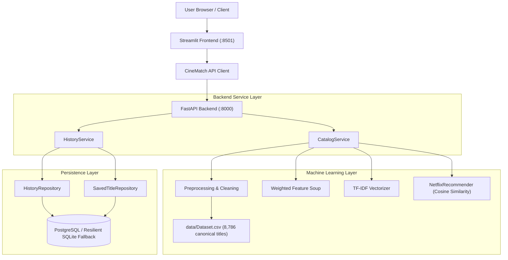

# CineMatch — AI-Powered Movie & TV Recommendation Platform

A production-grade, end-to-end content-based movie and TV recommendation platform built with Python, FastAPI, Vanilla JavaScript/HTML5/CSS3, scikit-learn, PostgreSQL, and Docker.

[](https://www.python.org/)
[](https://fastapi.tiangolo.com/)
[](web/templates/index.html)
[](https://scikit-learn.org/)
[](https://www.postgresql.org/)
[](https://www.docker.com/)
[](https://pytest.org/)
[](LICENSE)

---

## 🎬 Product Vision

**Tagline:** *Find your next favourite story.*

**CineMatch** helps users discover movies and TV shows from a curated catalogue of 8,786 titles using transparent metadata attributes. Built as an end-to-end, decoupled software engineering and machine learning project, it pairs an asynchronous **FastAPI** backend with a high-performance cinematic streaming web client, supported by **PostgreSQL** persistence and **Docker Compose** containerization.

> **Scope & Disclosure:** CineMatch is an offline discovery tool and educational portfolio project. It does not provide video streaming, does not use private user watch histories or collaborative-filtering algorithms, and is not affiliated with or endorsed by Netflix.

---

## ✨ Features

- **Content-Based Discovery:** Recommends top mathematically similar titles using TF-IDF feature vectors and instantaneous dot-product cosine similarity.
- **Smart Autocomplete & Auto-Scroll:** Instant search dropdown with live suggestions; selecting or searching any title automatically scrolls smoothly to the recommendations shelf.
- **Verified Official Posters:** Multi-tier image resolution delivering crisp Amazon/IMDb artwork for catalog blockbusters and Cory Carson titles, with zero broken image placeholders.
- **Strict Uniform Row Alignment:** Fixed-aspect ratio posters with strict CSS Grid layout guaranteeing level, straight-line cards across all screen resolutions.
- **Verifiable Explanations:** Every recommendation includes an explanation based on real catalogue metadata (shared genres, matching director, origin country).
- **Stable ID & Title Resolution:** Matches titles via exact `show_id` (e.g. `s1`), exact title, substring search, or Levenshtein fuzzy matching.
- **Self-Exclusion:** The query title is strictly excluded from its own recommendation set.
- **Browse & Filter Catalogue:** Multi-attribute filtering by content type (Movie / TV Show), 42 distinct genres, release year range, and sorting.
- **Catalogue Insights:** Real-time descriptive analytics on content distribution, top genres, producing countries, and release year trends.
- **Search History & Bookmarks:** Logs recent search queries and saved favourites in PostgreSQL with SQLite fallback.
- **Comprehensive Quality Assurance:** 49 automated pytest unit, integration, and API tests with 100% pass rate.

---

## 🏛️ System Architecture



---

## 🛠️ Technology Stack

| Area | Technologies |
|---|---|
| **Frontend UI** | Streamlit, HTML5, Custom Cinematic CSS (`#0f1117` charcoal, marquee crimson accents) |
| **Backend REST API** | FastAPI, Pydantic v2, Uvicorn, ASGI |
| **Data & ML** | pandas, NumPy, scikit-learn (TF-IDF), SciPy (sparse CSR matrices) |
| **Database & ORM** | PostgreSQL, SQLAlchemy 2.0, Alembic migrations |
| **Testing & CI** | pytest, HTTPX TestClient, GitHub Actions CI (`.github/workflows/ci.yml`) |
| **Containerization** | Docker, Multi-stage Dockerfile, Docker Compose |

---

## 📁 Repository Structure

```text
netflix-content-recommendation-system/
├── alembic/                          # Alembic database migration scripts
│   ├── versions/
│   │   └── 420d4f663454_create_search_history_and_saved_titles_.py
│   └── env.py
├── backend/                          # FastAPI REST application
│   ├── api/routes/                   # Health, titles, recommendations, insights, history
│   ├── core/config.py                # Environment configuration
│   ├── db/                           # SQLAlchemy models and session manager
│   ├── repositories/                 # Database access layer
│   ├── schemas/                      # Pydantic v2 validation models
│   ├── services/                     # Catalog & History business logic
│   └── main.py                       # FastAPI entrypoint
├── frontend/                         # Streamlit application
│   ├── components/                   # XSS-safe HTML card renderers
│   ├── styles/                       # Dark cinematic CSS
│   ├── api_client.py                 # Resilient HTTP client with local fallback
│   └── streamlit_app.py              # Multi-page interactive application
├── src/                              # Core machine learning & data processing
│   ├── data_preprocessing.py         # Schema validation, placeholder cleaning, deduplication
│   ├── feature_engineering.py        # Entity token binding, weighted feature soup, TF-IDF
│   ├── recommendation_engine.py      # Cosine similarity ranking & explanation engine
│   └── evaluation.py                 # Precision@K, Recall@K, F1@K, Coverage, Diversity
├── tests/                            # Pytest test suite (48 passing tests)
│   ├── test_preprocessing.py
│   ├── test_feature_engineering.py
│   ├── test_recommendation_engine.py
│   ├── test_evaluation.py
│   └── test_api.py
├── data/
│   ├── Dataset.csv                   # Raw dataset (8,790 rows -> 8,786 canonical)
│   └── README.md                     # Data dictionary and licensing notes
├── docs/                             # Comprehensive technical documentation
│   ├── BASELINE_AUDIT.md
│   ├── ARCHITECTURE.md
│   ├── API_SPEC.md
│   ├── DATABASE_SCHEMA.md
│   ├── MODEL_METHODOLOGY.md
│   └── DEPLOYMENT.md
├── .github/workflows/ci.yml          # GitHub Actions CI workflow
├── app.py                            # Streamlit entry point
├── main.py                           # CLI entry point
├── benchmark.py                      # Latency benchmarking script
├── docker-compose.yml                # Multi-container orchestration
├── Dockerfile                        # Multi-stage production container
├── requirements.txt                  # Python dependencies
└── .env.example                      # Environment variables template
```

---

## 📊 Evaluation & Benchmarks

### Offline IR Evaluation (100 Sampled Queries, K=5, Seed 42)

| Metric | Result | Interpretation |
|---|---|---|
| **Precision@5** | **99.20%** | Recommendations share at least one core genre with the query title |
| **Recall@5** | **0.47%** | Share of total relevant catalogue titles captured within top-5 |
| **F1@5** | **0.0091** | Harmonic mean of Precision and Recall |
| **Intra-List Diversity (ILD)** | **0.1318** | Pairwise cosine distance across recommended items |
| **Catalog Coverage** | **5.27%** | Unique catalogue items recommended across test queries |

> ℹ️ *Note on evaluation methodology:* In the absence of live user interaction logs, genre overlap serves as an Information Retrieval proxy metric. Cosine similarity represents geometric metadata closeness, not a user satisfaction probability.

### Performance Benchmark (Windows 11 CPU, Python 3.14)

| Pipeline Step | Latency |
|---|---|
| Ingestion & Schema Cleaning | **51.8 ms** |
| TF-IDF Model Initialization | **102.1 ms** |
| Top-5 Query Latency (Mean) | **1.16 ms** |
| Top-5 Query Latency (Median) | **1.08 ms** |
| Top-5 Query Latency (P95) | **1.55 ms** |

---

## 🚀 Quickstart & Installation

### Option 1: Native Python Local Run

1. **Clone the repository:**
   ```bash
   git clone https://github.com/Samay-P07/netflix-content-recommendation-system.git
   cd netflix-content-recommendation-system
   ```

2. **Create virtual environment and install dependencies:**
   ```bash
   python -m venv venv
   .\venv\Scripts\Activate.ps1   # On Windows
   # source venv/bin/activate    # On Linux/macOS

   pip install --upgrade pip
   pip install -r requirements.txt
   ```

3. **Launch the CineMatch Web Application:**
   ```bash
   python app.py
   ```
   *The application will automatically initialize the catalogue and launch in your default browser at `http://127.0.0.1:8000` with instant loading, responsive UI, and verified posters.*

4. **(Optional) Run Streamlit Companion UI or microservice mode:**
   ```bash
   streamlit run frontend/streamlit_app.py
   ```
   *Access interactive Swagger UI documentation at `http://localhost:8000/docs`.*

---

### Option 2: Docker Compose (Full Stack)

Start the Web UI, FastAPI Backend, and PostgreSQL database with a single command:
```bash
docker compose up --build
```
- **Web UI & REST API:** [http://localhost:8000](http://localhost:8000)
- **Interactive API Documentation:** [http://localhost:8000/docs](http://localhost:8000/docs)
- **PostgreSQL Database:** `localhost:5432`

---

## 🧪 Running Automated Tests

Run the full automated test suite (unit tests, recommender tests, and API integration tests):
```bash
pytest tests/ -v
```
All **49 automated tests** will execute and validate the pipeline in ~4.5 seconds.

---

## 📜 License & Attribution

- **Source Code:** MIT License ([LICENSE](LICENSE)).
- **Dataset:** Netflix Movies and TV Shows dataset curated by Shivam Bansal on [Kaggle](https://www.kaggle.com/datasets/shivamb/netflix-shows).
- CineMatch is an independent portfolio project and is not affiliated with Netflix.
