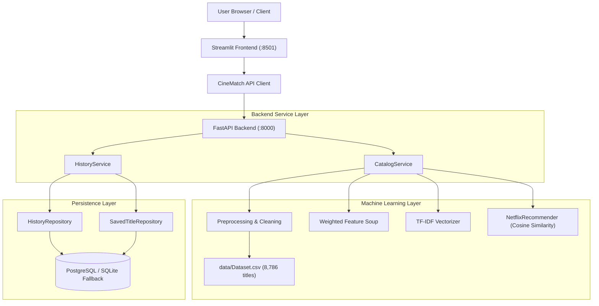

# CineMatch — Architecture & System Design

## 1. System Overview

**CineMatch** is an enterprise-structured content-based movie and TV recommendation platform. The platform adopts a decoupled microservice architecture:
- **Presentation Layer:** Streamlit-powered dark cinematic UI with custom CSS.
- **API Gateway / Backend Layer:** FastAPI high-performance asynchronous REST API.
- **Service & Domain Layer:** Domain services mediating business logic, query resolution, and catalog processing.
- **ML Engine Layer:** Sublinear TF-IDF vectorization and on-demand cosine similarity computing top-$K$ recommendations in $\approx 1.16$ ms.
- **Persistence Layer:** PostgreSQL managed via SQLAlchemy ORM and Alembic migrations, featuring resilient local fallback.

---

## 2. Component Responsibilities

| Component | Tech Stack | Responsibilities |
|---|---|---|
| **Frontend** | Streamlit, HTML5, Custom CSS | Interactive discovery UI, catalogue browser with multi-filter, dataset insight charts, history/favourites management, educational methodology display. |
| **API Client** | `httpx`, Python | Thin HTTP client communicating with backend with timeouts, connection retry, and automatic in-process fallback if backend is offline. |
| **Backend API** | FastAPI, Pydantic v2 | Exposes REST endpoints (`/titles`, `/recommendations`, `/insights`, `/history`), validates request payloads, enforces CORS security. |
| **Catalog Service** | Python, pandas | Mediates catalogue filtering, pagination, sorting, and metadata aggregation. |
| **Recommendation Engine**| scikit-learn, SciPy | Normalizes text metadata, builds weighted soup, transforms into sparse TF-IDF feature space, computes dot-product cosine similarity. |
| **Database Repositories**| SQLAlchemy 2.0 | Encapsulates database read/write queries for search history and saved favourites. |
| **Database Migrations** | Alembic | Version-controlled database schema migrations. |
