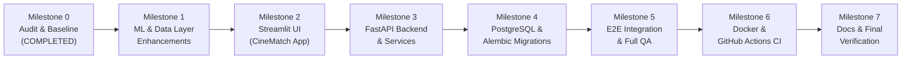

# CineMatch — Baseline Audit & Project Assessment (Milestone 0)

**Date:** 2026-11-13  
**Project:** CineMatch (Formerly Netflix Content Recommendation System)  
**Location:** `d:\ML Auspify\netflix-content-recommendation-system`  
**Author/Role:** Full-Stack & ML Engineering Team  

---

## 1. Executive Summary

A comprehensive baseline inspection was conducted on the existing repository and dataset. All existing test suites and CLI recommendation runs were executed in Python 3.14 on Windows 11. 

**Key Findings:**
1. **Algorithmic Integrity:** The content-based recommendation engine (TF-IDF vectorizer with sublinear term-frequency scaling and on-the-fly cosine similarity) is completely sound, robust, and verified with **34 passing pytest tests** (100% pass rate).
2. **Dataset Verification:** `data/Dataset.csv` contains **8,790 raw rows** and 10 specific metadata columns (`show_id`, `type`, `title`, `director`, `country`, `date_added`, `release_year`, `rating`, `duration`, `listed_in`). Neither `cast` nor `description` is present in this dataset; therefore, metadata features are accurately derived from genres, directors, countries, ratings, and content types without fabricating missing columns.
3. **Environment & Infrastructure:** A native PostgreSQL 18 service (`postgresql-x64-18`) is actively running on the host system. Docker is not installed on this local Windows machine; therefore, containerization files (`Dockerfile`, `docker-compose.yml`) will be provided alongside fully functional native Python execution instructions.
4. **Preservation Commitment:** The working recommendation engine (`src/data_preprocessing.py`, `src/feature_engineering.py`, `src/recommendation_engine.py`, `src/evaluation.py`) and all existing tests will be strictly preserved and built upon, avoiding duplicate or disconnected ML code.

---

## 2. Inventory of Existing Assets

```text
netflix-content-recommendation-system/
├── data/
│   ├── Dataset.csv                       # 8,790 raw records (1.07 MB)
│   └── README.md                         # Data dictionary and licensing notes
├── notebooks/
│   └── exploratory_analysis.ipynb        # EDA notebook
├── src/
│   ├── __init__.py                       # Package exports
│   ├── data_preprocessing.py             # Schema validation, cleaning, deduplication (8,786 rows)
│   ├── feature_engineering.py            # Metadata soup construction, genre weighting, TF-IDF
│   ├── recommendation_engine.py          # Exact/substring/fuzzy matching, cosine similarity
│   └── evaluation.py                     # Precision@K, Recall@K, F1@K, Catalog Coverage, ILD
├── tests/
│   ├── __init__.py
│   ├── test_preprocessing.py             # 7 tests
│   ├── test_feature_engineering.py       # 6 tests
│   ├── test_recommendation_engine.py     # 13 tests
│   └── test_evaluation.py                # 8 tests
├── app.py                                # Single-page Streamlit prototype
├── main.py                               # CLI entrypoint for recommendations & evaluation
├── benchmark.py                          # Latency benchmarking script (1.16 ms avg latency)
├── requirements.txt                      # Dependencies (numpy, pandas, scikit-learn, etc.)
├── LICENSE                               # MIT License
└── README.md                             # Comprehensive technical documentation
```

---

## 3. Verified Baseline Test & Execution Results

### 3.1 Pytest Suite
Executed command: `python -m pytest tests/ -v`
- **Result:** **34 passed in 11.08s**
- **Test Coverage:**
  - Preprocessing: File existence, column validation, placeholder purging (`Not Given`, `Unknown`), whitespace stripping, empty title removal, deduplication.
  - Feature Engineering: Entity token binding (`christopher_nolan`, `united_states`), genre normalization, genre weighting multiplier, TF-IDF transform.
  - Recommendation Engine: Fuzzy/exact/substring title resolution, top-K boundaries, format filtering (`Movie`/`TV Show`), self-exclusion.
  - Evaluation: Precision@K, Recall@K, F1@K calculation with dynamic denominator $\min(K, |\text{recs}|)$, Catalog Coverage, Intra-List Diversity (ILD).

### 3.2 CLI Recommendation
Executed command: `python main.py --title "Inception" --top_k 5`
- **Query Item:** Inception (2010) | Movie | PG-13
- **Output:** Correctly returned 5 similar Sci-Fi & Fantasy/Thriller movies (*The Box*, *The Signal*, *Dragonheart*, *Clash of the Titans*, *Seventh Son*) with similarity scores between 86% and 89%, excluding the query title itself.

### 3.3 Benchmark Execution
- Ingestion & preprocessing: ~51.8 ms
- TF-IDF initialization: ~102.1 ms
- Query latency (Top-5): Mean ~1.16 ms, Median ~1.08 ms, P95 ~1.55 ms.

---

## 4. Current Architecture vs. CineMatch Target Vision

| Component | Current State | Target CineMatch Architecture |
|---|---|---|
| **Branding & Theme** | Netflix Content Recommendation System (red/dark) | **CineMatch — AI-Powered Movie & TV Discovery** (cinematic, refined, dark charcoal `#12151c` with crimson accents) |
| **Frontend UI** | Single-page Streamlit prototype with basic tabs | Multi-view Streamlit platform (Home/Discover, Search & Catalogue with multi-filter & sorting, Title Details, Explainable Recommendations, Dataset Insights, Search History & Favourites, Methodology) |
| **Recommendation Engine** | In-memory recommender matching by title text | Enhanced recommender with stable IDs (`show_id`), deterministic ranking, and **verifiable metadata explanation** (e.g. "Shares genres: Sci-Fi, Thrillers; Same country: United States") |
| **Backend API** | None (CLI and in-process Streamlit only) | Modular **FastAPI REST API** (`/health`, `/titles`, `/titles/search`, `/titles/{id}`, `/recommendations/{id}`, `/insights/overview`, `/history`), Pydantic schemas, service layer, CORS |
| **Database** | None | **PostgreSQL** via SQLAlchemy ORM & Alembic migrations for search history & saved titles; graceful fallback if DB is unreachable |
| **Persistence Integration**| None | UI calls API Client -> FastAPI -> Service -> Repository -> PostgreSQL |
| **DevOps & Containers** | None | `Dockerfile`, `docker-compose.yml`, GitHub Actions CI workflow (`.github/workflows/ci.yml`) |

---

## 5. Implementation Sequence (Milestones 1 – 7)



### Detailed Roadmap:

- **Milestone 1 — Recommendation Engine & Data Layer:**
  - Maintain existing preprocessing, feature engineering, and TF-IDF pipeline.
  - Add stable title ID resolution using `show_id` (e.g., `s1`, `s2`) as primary key.
  - Implement metadata explanation generator (shared genres, shared directors, shared country).
  - Add unit tests for stable ID lookup and explanation logic.

- **Milestone 2 — Streamlit Product UI (CineMatch):**
  - Implement navigation: Home/Discover, Search & Catalogue, Title Details, Similar Titles, Dataset Insights, History & Favourites, Methodology.
  - Custom dark cinematic CSS styling, cards, badges, and responsive layouts.
  - Multi-attribute catalog filtering (Content Type, Genre, Year range, Sort by A-Z / Year).
  - Connect UI to an API Client abstraction with direct local fallback.

- **Milestone 3 — FastAPI Backend & Services:**
  - Create FastAPI application (`backend/main.py`) with routers for titles, recommendations, insights, and history.
  - Define strict Pydantic schemas for requests and responses.
  - Implement service layer decoupling HTTP controllers from ML and database logic.
  - Add API unit and integration tests using `httpx.AsyncClient` / `TestClient`.

- **Milestone 4 — PostgreSQL Persistence & Alembic:**
  - Define SQLAlchemy models for `search_history` and `saved_titles`.
  - Configure Alembic migrations.
  - Build Repository layer for search history tracking and clearing.
  - Implement graceful degradation: if PostgreSQL is disconnected, log warning and let recommendations continue seamlessly.

- **Milestone 5 — End-to-End Integration & Comprehensive QA:**
  - Wire Streamlit UI to FastAPI endpoints via `api_client.py`.
  - Verify every user journey (search, filter, view details, get recommendations, view history, clear history, view charts).
  - Run full test suite covering ML, API, and database services.

- **Milestone 6 — Docker & CI Automation:**
  - Create multi-stage `Dockerfile` and `docker-compose.yml` for Frontend, Backend, and PostgreSQL.
  - Create GitHub Actions workflow (`.github/workflows/ci.yml`) for linting, type-checking, and pytest runs.

- **Milestone 7 — Final Documentation & Portfolio Release:**
  - Author comprehensive `README.md`, `docs/ARCHITECTURE.md`, `docs/API_SPEC.md`, `docs/DATABASE_SCHEMA.md`, `docs/MODEL_METHODOLOGY.md`, and `docs/DEPLOYMENT.md`.
  - Provide exact reproduction commands for local and Docker setups.
