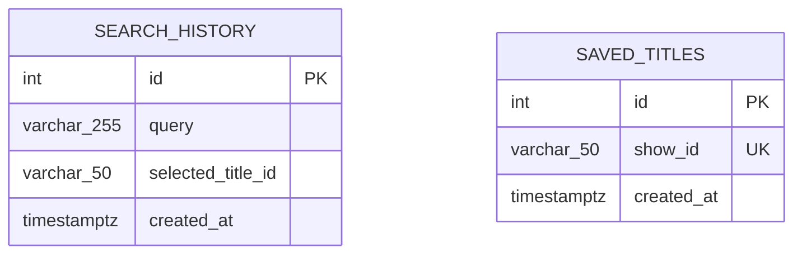

# CineMatch — Database Schema & Persistence Design

## 1. Relational Data Model

CineMatch uses PostgreSQL for persistent user interactions (search history and bookmarks). The static catalogue data (8,786 rows) is loaded into in-memory SciPy sparse matrices and pandas DataFrames for high-throughput $O(1)$ and $O(N)$ vector operations, while stateful interactions are stored in PostgreSQL.



---

## 2. Table Specifications

### 2.1 `search_history`
Tracks user search queries and associated selected title identifiers.

| Column | Type | Constraints | Description |
|---|---|---|---|
| `id` | `INTEGER` | Primary Key, Auto-increment | Unique log entry ID |
| `query` | `VARCHAR(255)` | NOT NULL | User query text |
| `selected_title_id` | `VARCHAR(50)` | Nullable | Selected title `show_id` (e.g. `s1`) |
| `created_at` | `TIMESTAMPTZ` | NOT NULL, Indexed | Timestamp of search |

**Indexes:**
- `ix_search_history_id` (`id`)
- `idx_search_history_created_at` (`created_at`)

---

### 2.2 `saved_titles`
Stores bookmarked or favourite titles.

| Column | Type | Constraints | Description |
|---|---|---|---|
| `id` | `INTEGER` | Primary Key, Auto-increment | Unique record ID |
| `show_id` | `VARCHAR(50)` | NOT NULL, Unique, Indexed | Catalogue show ID (e.g. `s1`, `s824`) |
| `created_at` | `TIMESTAMPTZ` | NOT NULL | Bookmark creation timestamp |

**Indexes:**
- `ix_saved_titles_id` (`id`)
- `ix_saved_titles_show_id` (`show_id`, UNIQUE)

---

## 3. Database Migrations (Alembic)

Database schemas are tracked using Alembic.
- **Migration Script:** `alembic/versions/420d4f663454_create_search_history_and_saved_titles_.py`
- **Commands:**
  ```bash
  # Apply latest migrations
  alembic upgrade head

  # Rollback migration
  alembic downgrade -1
  ```
